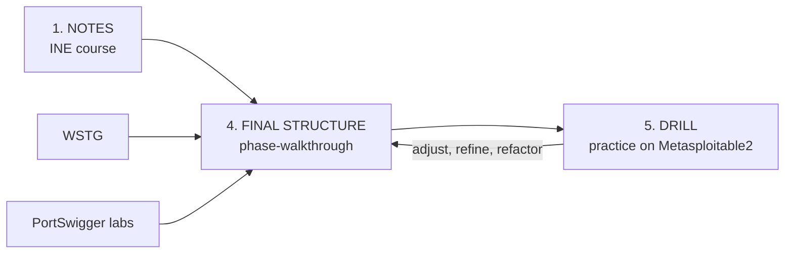

# eWPTv2 Notes

Personal study vault for the INE eWPTv2 (Web Application Penetration Tester) exam. The goal is a small, exam-aligned set of files that can be opened during the exam and followed phase by phase.

## Core idea

- The INE course is a base for understanding what pentesting is. It is not enough to pass.
- The **phase walkthrough** is the core document of each phase. Everything else supports it.
- Each walkthrough is refined by practicing it in `5. DRILL` and feeding the findings back.

## Repository layout

| Folder | Purpose | Priority |
|---|---|---|
| [4. FINAL STRUCTURE](4.%20FINAL%20STRUCTURE) | Files meant to be available during the exam | Core |
| [5. DRILL](5.%20DRILL) | Practice runs that refine the final structure | Core |
| [3. EXAM STRATEGY](3.%20EXAM%20STRATEGY) | How to approach the exam, plus answered doubts | Support |
| [2. REPORTS](2.%20REPORTS) | Documentation template used as an anchor while testing | Support |
| [1. NOTES](1.%20NOTES) | Notes from the INE course | Reference only |
| 6. EXPERIMENTS | Not relevant for now | Ignore |

### 1. NOTES

Notes taken during the INE tutorials, one folder per chapter. They are kept as reference only. The course has these gaps:

- Many parts cover tooling that is outdated or cannot be used in the exam.
- It does not explain how to align with the exam environment.
- It does not explain how to proceed through the different phases.

### 2. REPORTS

A reporting deliverable is no longer required for the exam. [target-report-template.md](2.%20REPORTS/target-report-template.md) is kept only as a structure for documenting progress while testing.

### 3. EXAM STRATEGY

- [guideline.md](3.%20EXAM%20STRATEGY/guideline.md): exam facts, scope, workflow, tool rules and preparation order.
- [exam_doubts_faq.md](3.%20EXAM%20STRATEGY/exam_doubts_faq.md): doubts that came up while studying, exam-day mechanics and open questions.

### 4. FINAL STRUCTURE

The exam-time vault. Its skeleton follows the INE chapters and is cross-referenced with the [WSTG](https://owasp.org/www-project-web-security-testing-guide/) and the PortSwigger labs ([ine-to-wstg.md](4.%20FINAL%20STRUCTURE/ine-to-wstg.md), [port_swigger_categories.md](4.%20FINAL%20STRUCTURE/port_swigger_categories.md), [structure_example.md](4.%20FINAL%20STRUCTURE/structure_example.md)).

Each phase folder follows the same shape:

| File | Role |
|---|---|
| `🧭 phase-walkthrough.md` | **Core.** Hybrid theory and practice guide through the phase. Built by cross-referencing WSTG, INE and PortSwigger labs |
| `📜 cheatsheet.md` | Extended command database, used when the main commands do not apply or fail |
| `📝 notes.md` | Condensed INE notes for the phase |
| `🧪 LABS/` | Practical labs summarized in markdown |
| `faq.md` | Doubts and improvements for the phase |

Current state:

| Folder | Status |
|---|---|
| `00-Exam-Setup-and-Proxies` | Startup checklist |
| `01 - Info-Gathering-and-Recon` | Full structure, drilled |
| `02 - XSS-and-Client-Side` | Cheatsheet, walkthrough and labs in progress |
| Remaining phases | Pending: same structure will be replicated |

### 5. DRILL

Practice area where each walkthrough is executed and improved:

1. Run the phase walkthrough against a target, mainly [Metasploitable2](4.%20FINAL%20STRUCTURE/01%20-%20Info-Gathering-and-Recon/Metasploitable2) (Mutillidae).
2. Store command outputs as files per attempt (`attemptN/`).
3. Note what broke, was missing or was unnecessary.
4. Adjust, shape and refactor the walkthrough, cheatsheet and FAQ.
5. Repeat until the process is aligned with the exam context.

Progress is tracked in [iterations.md](5.%20DRILL/iterations.md).

## Suggested usage

1. Read [guideline.md](3.%20EXAM%20STRATEGY/guideline.md) for the exam rules and workflow.
2. Work from `4. FINAL STRUCTURE`, starting with `00-Exam-Setup-and-Proxies` and then each `phase-walkthrough.md` in order.
3. Reach for the phase `cheatsheet.md` and `faq.md` when the walkthrough is not enough.
4. Use `1. NOTES` only to look up background theory.
